<div align="center">



# Tranquil Automations

**Write TypeScript and run it against live browser tabs — the automation layer of [Tranquil Studio](https://github.com/tranquillabs/tranquil-client).**

</div>

---

## What it is

`tranquil-automations` scripts live web apps from inside Tranquil Studio. Write a `.ts` file and run
it against the active browser tab with **⌘⇧R** (whole file or a selection, REPL-style), or register
any `.ts` as a named palette command. Scripts get a `tranquil` namespace with direct-CDP page
control, background/off-screen pages, file I/O, and notifications. It also powers several tree-view
and tab UI enhancements.

## Features

- **Run TS against a live tab** — ⌘⇧R runs the whole file or the current selection.
- **`tranquil` namespace** — direct-CDP page control, background pages, file I/O, desktop notifications.
- **Named commands** — register any `.ts` as an "Automations:" palette command.
- **Workspace UI** — vertical tab-list dock panel, tree-view row actions, folder-count pills, pane controls.

## Permissions

Every automation declares what it may reach, in the leading comment block. A script
without a `@permissions` line is refused.

```ts
// @permissions browser net=api.github.com
// @timeout 15m
```

| Grant | Allows |
| --- | --- |
| `none` | Nothing: no files, network or browser |
| `browser` | Drive tabs — open pages and run code in them, in your signed-in sessions |
| `clipboard` | Read and write the system clipboard |
| `net=host,…` | Network access to those hosts |
| `read=path,…` / `write=path,…` | Those files and folders, relative to the script's folder |
| `env=NAME,…` | Environment variables |
| `run=bin,…` | Run commands (effectively full user privilege) |
| `import=host,…` | Module imports beyond `jsr.io` |

A script gets no files by default, not even its own folder: it names each one in `read=` or
`write=`. A header that grants anything asks for approval the first time it runs, remembered
until the declaration changes.

## Install

Bundled with Tranquil Studio. To run from source, follow the
[Local Dev Setup runbook](https://tranquillabs.dev/docs/development/getting-started/local-dev-setup).

## License

[MIT](LICENSE.md) © Tranquil Labs.
